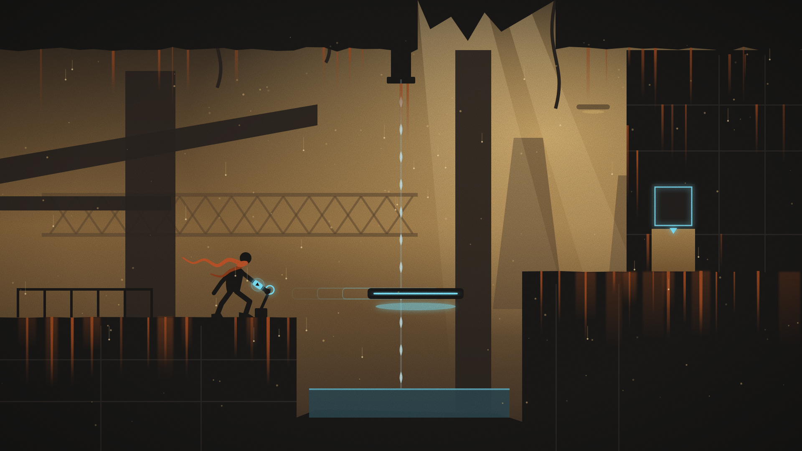
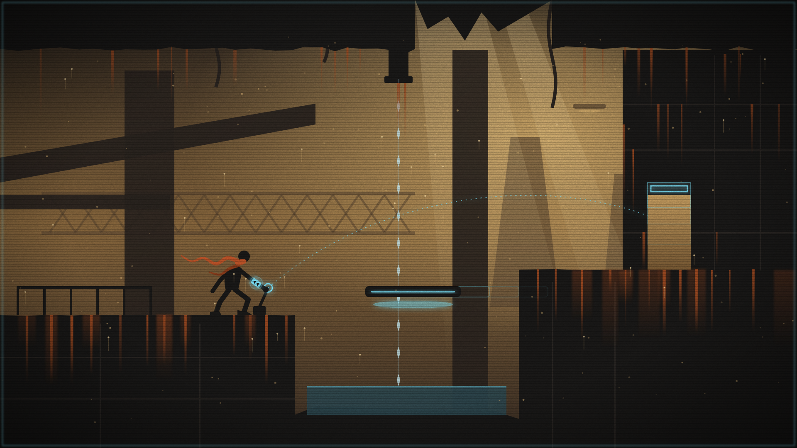

# Shift Time

2D-головоломка-платформер на Godot для джема **Game Off 2026** (тема SHIFT). Игрок всегда живёт вперёд, а удержание **Shift** обращает время мира: двери закрываются назад, вода поднимается, сгоревшее дерево восстанавливается, разбитая лампа собирается. Если игрок вмешивается, пока мир идёт назад, история ветвится и дальше идёт по-новому.

- **Цель:** победа на Game Off 2026. Сдаём 30.11, крайний срок — 1.12, 21:37 UTC (13:37 по тихоокеанскому времени).
- **Результат:** страница на itch.io, где игра запускается прямо в браузере. Ссылка появится здесь после задачи 2.0. Сборка для Windows — дополнительно.
- **Объём:** 10 уровней (нижняя граница — 7), каждый вводит одну механику: механизмы, вода, огонь, свет и тьма, обратные предметы, причина и следствие, вмешательство в прошлое.
- **После джема игру продаём**, поэтому все картинки и звуки — только с правом коммерческого использования.

## Документы

- Правила игры и объём — [docs/concept.md](docs/concept.md).
- План: недели, ворота, задачи с метками, список урезания — [docs/roadmap.md](docs/roadmap.md).
- Где мы, кто что делает, что дальше — [docs/progress.md](docs/progress.md).
- Общие вопросы и ответы — [docs/decisions.md](docs/decisions.md); решения с причинами и журнал чатов — [docs/history.md](docs/history.md).
- Как работать: инструменты, первые сообщения, настройка Antigravity — [docs/how-we-work.md](docs/how-we-work.md).
- Архитектура (модель времени, папки, тесты, CI) — [docs/architecture.md](docs/architecture.md).
- Карточки уровней — [docs/levels/](docs/levels/README.md).
- Стиль: тест трёх вариантов — [docs/style.md](docs/style.md); сеттинг — [docs/setting.md](docs/setting.md); арт-пайплайн — [docs/art-pipeline.md](docs/art-pipeline.md); нейросети для картинки и звука — [docs/ai-tools.md](docs/ai-tools.md).
- Исследования: рынок, механики похожих игр, планы после джема — [docs/research/](docs/research/README.md).
- Правила для ИИ: [CLAUDE.md](CLAUDE.md) читает Claude Code, [AGENTS.md](AGENTS.md) — Antigravity и другие агенты.

## Что уже есть (8.11.2026)

- Проект Godot 4.7.2: игрок и тестовая комната (задача 1.1), Shift меняет направление времени, в углу — временная надпись направления (1.2), запись истории комнаты — `Timeline` и `TemporalRecorder` (1.3).
- 28 тестов правил и UI-тест; GitHub прогоняет их на каждый пуш (проверка «Tests»).
- Правила времени для 10 уровней (решения 8.11), черновики карточек уровней 01–07; карточки 08–10 — задача 2.4.
- Стиль выбираем 11.11 из трёх вариантов ([docs/style.md](docs/style.md)). Ниже — образец старого варианта «силуэт», это не игровая сцена: слева обычное время, справа обратное.





## Что получится к сдаче

- Shift обращает время мира и не откатывает игрока; отпустил Shift — мир проигрывает записанное будущее;
- двери, платформы, ящики, кнопки, рычаги, шестерни и вода, которые записывают свою историю;
- живые источники: игрок и обратные предметы (обратный огнемёт, батут) действуют по текущему направлению времени;
- огонь по зонам дерева, тьма и лампа;
- история ветвится, когда игрок вмешивается в обратном режиме;
- уровни, которые начинаются со следствия, а причину игрок ищет сам;
- тест решения для каждого уровня: он проигрывает записанные нажатия и доводит до выхода;
- веб-сборка на странице itch.io и сборка для Windows.

Сюжета, озвучки, настоящей физики жидкостей и произвольной физики в обратном времени в этой главе нет.

## Управление

| Действие | Клавиша |
| --- | --- |
| Движение | A / D или ← / → |
| Прыжок | Пробел, W или ↑ |
| Взаимодействие (кнопка, рычаг, ящик) | E |
| Обратное время | удерживать Shift или Q |
| Сброс уровня | R |
| Пауза | Esc |
| Вернуться из уровня в список | Backspace |

## Как играть в браузере

После задачи 2.0 здесь будет ссылка на страницу itch.io. Там же, в задаче 2.0, появится команда, которой веб-версию можно собрать самому (её запишут в [CLAUDE.md](CLAUDE.md), раздел «Commands»). После задачи 4.5 GitHub будет собирать веб-версию сам после каждого слитого PR.

## Как запустить на компьютере

1. Установите [GitHub Desktop](https://desktop.github.com), войдите в GitHub и склонируйте репозиторий `ArtemPridyba/shift-time`. Перед каждым запуском нажимайте Fetch origin, затем Pull origin. Если Pull не проходит из-за изменений в папке (их часто делает сам Godot), нажмите правой кнопкой на список Changes → Discard all changes.
2. Скачайте Godot 4.7.2, версию Standard (не .NET): для Windows — [Godot_v4.7.2-stable_win64.exe.zip](https://github.com/godotengine/godot/releases/download/4.7.2-stable/Godot_v4.7.2-stable_win64.exe.zip), для других систем — со [страницы версии](https://github.com/godotengine/godot/releases/tag/4.7.2-stable). Новее не берите: проект и тесты сделаны на 4.7.2, и версия у всех должна быть одна. Устанавливать не нужно — достаточно распаковать.
3. Запустите `Godot_v4.7.2-stable_win64.exe` (файл с `_console` в имени не нужен), нажмите Import и выберите `game/project.godot` в папке репозитория.
4. Нажмите F5 или ▶ справа вверху.

Сохранение прогресса по уровням появится в задаче 4.2.

## Сборка для Windows

Появится в задаче 4.5: после каждого слитого PR в `main` GitHub прогонит тесты, соберёт игру и выложит её на страницу [Releases](https://github.com/ArtemPridyba/shift-time/releases) как «Build N». Репозиторий публичный, поэтому скачать сборку можно без входа в GitHub.

1. Скачайте архив последней сборки со страницы Releases.
2. Распакуйте его и запустите `.exe`.
3. Если Windows пишет, что программа ненадёжна, нажмите «Подробнее» → «Выполнить в любом случае»: сборка не подписана сертификатом.

Собрать заново без нового PR: вкладка Actions → Build → Run workflow.

## Как мы работаем

Двое, права равные. Работу делят по меткам задач в [docs/roadmap.md](docs/roadmap.md):

| Метка | Кто делает | Где |
| --- | --- | --- |
| О, О+ | Opus: ядро времени, первый образец каждого вида работы, самые сложные уровни | Claude Code (или Opus в Antigravity) |
| А, А− | Gemini 4 Argon, без неё — Claude Sonnet или Gemini Flash: объекты и уровни по образцу, сборка, меню, звук и картинка в игре, документы | Antigravity; А — и Claude Code на Sonnet |
| Г | Gemini: картинки, видео для анимации, музыка, второе мнение, разбор видео плейтеста | приложение Gemini |
| Л | люди: стиль, плейтест, страница itch, решения | — |

Одна задача — один чат — одна ветка — один PR. Кто что делает сейчас, видно в [docs/progress.md](docs/progress.md). Как начать чат, настроить Antigravity и закончить задачу — в [docs/how-we-work.md](docs/how-we-work.md). Сливайте PR до следующего чата: иначе новый чат этой работы не увидит.

## Числа без кода

Числа и настройки лежат в `game/data/`:

| Файл | Что в нём |
| --- | --- |
| `time.json` | шаг записи, длина истории в секундах, порог скачка для тестов непрерывности |
| `player.json` | скорость, прыжок и другие числа героя |
| `levels.json` | список уровней и порядок прохождения |

Проще всего попросить в чате: «сделай историю короче», «добавь уровень 03 по карточке». После правки запустите тесты: они проверяют, что файлы читаются без ошибок, а у каждого уровня есть решение, которое доводит до выхода (`game/tests/solutions/level_NN.json`). Если правка сломала решение, тест упадёт и назовёт уровень.

## Тесты

Из корня репозитория:

```
godot --headless --path game --import
godot --headless --path game --script res://tests/test_runner.gd
godot --headless --path game --script res://tests/ui_smoke_test.gd
```

Первая команда нужна после клонирования и когда в проекте появились новые скрипты. Вторая проверяет правила времени: направление, запись и воспроизведение, ветвление, детерминизм и решения уровней. Третья — экран. На Windows обе проверки запускает `run_tests.bat` (двойной щелчок): он берёт `godot` из PATH или `C:\Godot\Godot_v4.7.2-stable_win64_console.exe`, другой путь задаёт переменная `GODOT`.

GitHub прогоняет оба теста на каждый пуш — проверка «Tests» внизу страницы PR:

- зелёная галочка — можно сливать;
- красный крестик — не сливайте: в новом чате напишите «почини проверку в PR №…»; что упало, видно по ссылке Details;
- жёлтый кружок — проверка ещё идёт.

Версия Godot для GitHub записана в `.github/actions/install-godot/action.yml` вместе с контрольной суммой. В облачных чатах Claude Code Godot ставит хук начала сессии (`.claude/hooks/session-start.sh`) по той же записи.

## Открытый репозиторий

- Джем требует публичный репозиторий: его читают все, другие команды тоже.
- Ключи и пароли — только в GitHub Secrets, никогда в файлах.
- Каждый чужой файл — строка в `CREDITS`; каждый файл от нейросети — строка в `docs/art/log.md`: сервис, запрос, лицензия.
- Форма джема спросит, как использовали ИИ. Пишем честно: код — Claude и Gemini, картинки и звуки — нейросети по журналу ассетов.
- Файла лицензии нет: все права у команды. Решение — вопрос D17 в [docs/decisions.md](docs/decisions.md).
