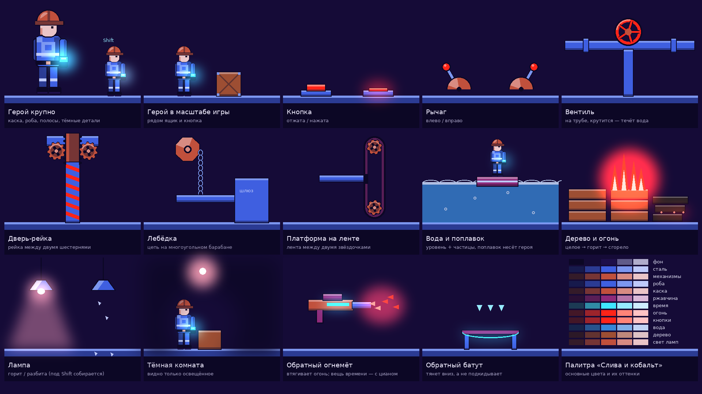
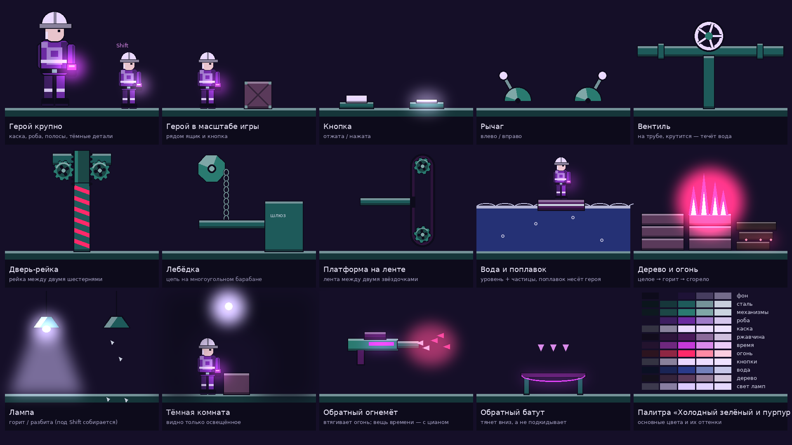
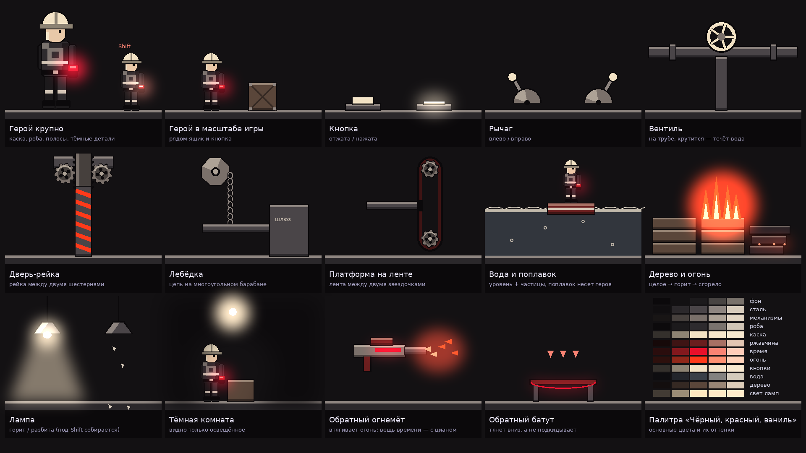

# Палитра

Первая часть задачи Д1 (18.11.2026). Здесь сохраняем **только цвета**: роли, оттенки, свет, акценты. Формы объектов на листах ниже — черновик для показа цвета, в дизайн они не идут (решение Артёма 18.11).

Цвета в игре берутся из `game/data/art.json`: там три палитры, активная — в поле `active_palette`. Сменить палитру всей игры — поменять одно поле. Проверка данных — `Content.validate_art` (тест `test_art_palettes_are_checked`).

## Как устроена палитра

- **Мало основных цветов, остальное — их оттенки.** У каждой палитры 6–8 сочных основных цветов; у каждого 5 оттенков от тёмного к светлому (`art.json`, `ramps`, индекс 2 — сам основной цвет).
- **Оттенки сходятся.** Тёмные концы всех цветов тянутся к одному общему тёмному, светлые — к одному общему светлому (смешение в OKLab). Поэтому сочные цвета не разбегаются и читаются как один набор. Скрипт — `tools/palette/objects.py`.
- **Роли.** Палитра даёт цвет не предмету, а роли: фон, сталь (платформы, трубы, бетон), механизмы (шестерни, рейки, барабаны), роба и каска героя, ржавчина, время, огонь, точки взаимодействия (кнопки, рычаги, вентили), вода, дерево, свет ламп; плюс цвет кожи. Список ролей — `Content.ART_ROLES`.
- **Правило рисования для всех предметов:** тёмный контур (самый тёмный оттенок фона), тело — основной цвет, светлая кромка сверху (свет сверху слева), тень снизу. Износ — сколы краски до металла по рёбрам, грязь у пола, пыль на верхних гранях; ржавчина только на старом железе (цепи, болты, колонны), без потёков по стенам.

> **18.11, позже:** «Слива и кобальт» убрана (синий забраковали). Основная теперь «Вино и латунь» (`wine_brass`), запасная «Графит и бронза» (`graphite_bronze`) — см. [history.md](../history.md) и снимок [style/perspective_step3.png](style/perspective_step3.png). Ниже — как было.

## Была основной: «Слива и кобальт» (`plum_cobalt`)

Тёмная холодная ночь, всё сочное. Основа — Copper Tech (Arne Jansson), сдвинутая к насыщенным цветам по референсу Артёма (сочные «конфетные» сочетания).

| Роль | Основной цвет | Где |
|---|---|---|
| фон | `#1e0f4a` слива-индиго | стены, дальний план |
| сталь | `#3f5fe0` кобальт | платформы, трубы, пол, роба |
| механизмы | `#c0503c` красная медь | шестерни, рейки, барабаны, каска, свет ламп |
| ржавчина | `#8e2a7a` слива | колонны, старое железо |
| время | `#3fe6ff` циан | устройство на руке, вещи времени |
| огонь | `#ff2418` алый | огонь, кнопки, полосы опасности |

Общий тёмный `#08051c`, общий светлый `#f4f0ff`. Вода и дерево — смеси (кобальт с бирюзой, медь с коричневым).

Как выбирали (18.11): четыре готовые палитры (Endesga 32, AAP-64, Copper Tech, Zughy 32) → ближе всех Copper Tech → узкие палитры из 6 цветов → насыщенные «конфетные» по референсу → «Ночная карамель» → медь без жёлтого, алый огонь → красная медь с четырьмя наборами остальных цветов ([сравнение](palette/plum_cobalt_options.png)) → набор B «Слива и кобальт».

## Запасная 1: «Холодный зелёный и пурпур» (`green_purple`)

Та же схема «основа + один контрастный + один светлый»: холодный тёмный зелёный `#1e5a5a`/`#2a7a70` — весь металл (сталь, трубы, платформы, шестерни); фиолетовый — фон `#1e1236` и роба героя `#6a2aa0`; **пурпурный `#c43ad8` — время**; огонь и полосы опасности — малиново-розовые `#ff2a6a`; светлая сирень `#ead8ff` — каска, кнопки, блики, свет ламп. Зелёный и фиолетовый — противоположные цвета, поэтому герой сразу виден на зелёном железе. Время не циан — отступление от D47. Заменила «Мятный день» (светлая палитра, 18.11): Артём выбрал вариант P2 из двух фиолетово-зелёных (P1 — фиолетовая основа с зелёным акцентом — терял зелёный).

## Запасная 2: «Чёрный, красный, ваниль» (`black_red_vanilla`)

Схема «тёмная основа + один контрастный + один светлый»: всё остальное — их оттенки. Чёрный и тёмно-серый — фон, сталь, механизмы (тёплый серый), роба, вода, дерево. **Красный `#e8102a` — время и опасность**: устройство на руке, вещи времени, огонь, полосы опасности, тёмная ржавчина; циана нет (отступление от D47), время и огонь различаются формой и движением. **Ваниль `#f2e2c4` — всё светлое**: каска, полосы, блики, кнопки и рычаги, свет ламп, кожа. Графично, как нуар: глаз сразу находит красное. Заменила «Шоколад и неон» (Артём, 18.11: эта лучше).

## Открыто

- Циан на механизмах: в черновиках шестерни в обычном ходе без циана, под Shift — циановый обод и метки на колонне (вопрос в [decisions.md](../decisions.md)).
- Свет ламп в основной палитре розоватый (светлая медь): если нужен теплее — один светлый янтарный оттенок только для света.

## Пересобрать листы

`python3 -I tools/palette/objects.py out.png tools/palette B` (или `P2` — холодный зелёный и пурпур, `X` — чёрный, красный, ваниль; в скрипте остались и пройденные варианты `M`, `S`, `P1`); пятый аргумент — файл, куда записать роли палитры в JSON (так собран `art.json`).
