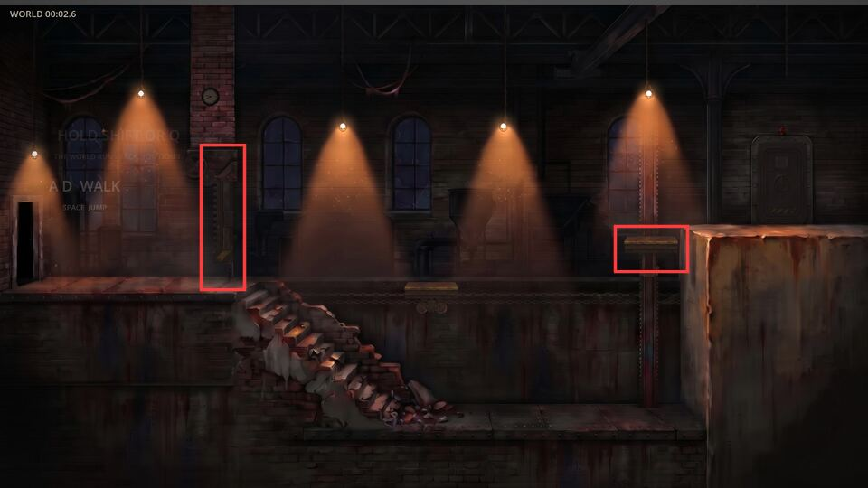
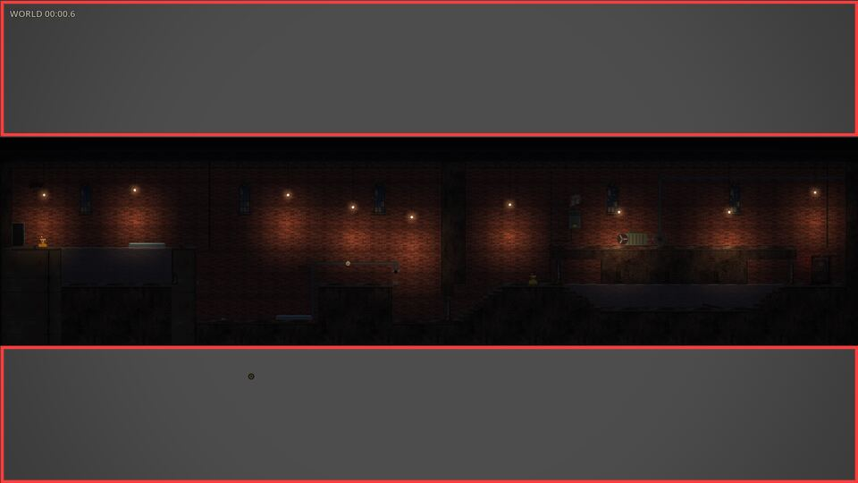
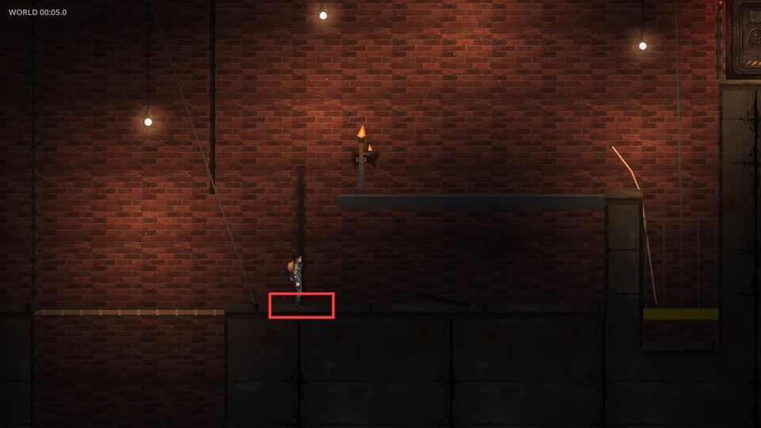
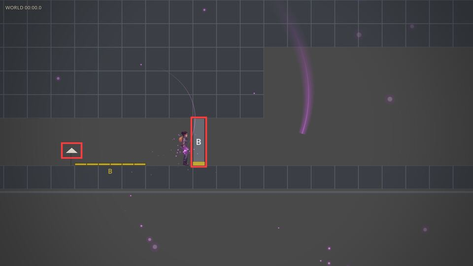
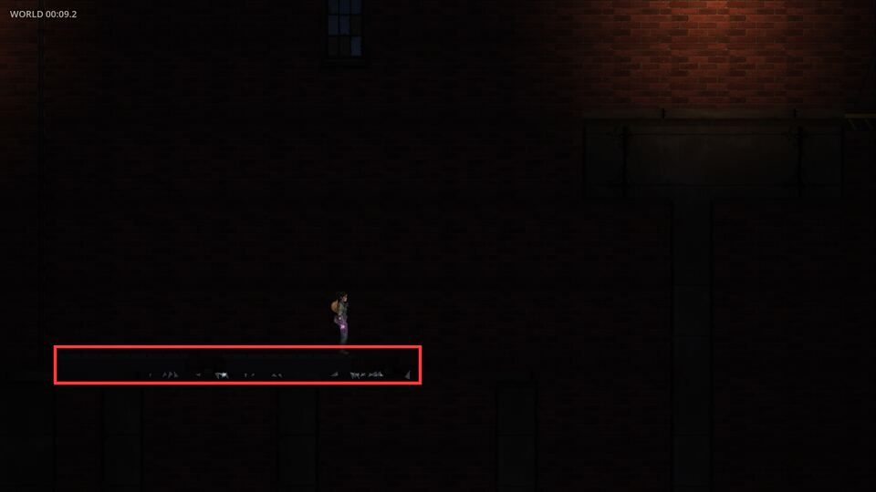

# Плейтест по кадрам: уровни 01–05 глазами новичка (27.11.2026)

Взгляд со стороны, как будто человек впервые открыл игру на itch и карточек не читал. Это не живой плейтест: играл не человек, а записанное решение уровня (`game/tests/solutions/level_NN.json`) в настоящем рендере, по кадру каждые 0,5 с, плюс кадры 1, 2 и 5 сразу после входа:

```
tools/shots.sh level_NN --every 30 --scale 0.5 --at 1,2,5
```

Кадры — в папке [2026-11-27-ai-review/](2026-11-27-ai-review/) (JPG 960×540, красные рамки — то, о чём речь). Состояние — `main` на 27.11 (после PR #116): звук, подсказки «E» и трафареты D179–D180 уже есть; уровни 06–08, 03 v3 и концовка 05 (D176) делаются параллельно и здесь не учтены.

Важность:
- **мешает пройти** — новичок, скорее всего, застрянет или бросит;
- **путает** — пройдёт, но не поймёт почему, или потратит лишние минуты;
- **мелочь** — шероховатость.

Каждая правка — на полчаса: число в `game/data`, свет, надпись, камера. Где нужна строка кода, это сказано.

## Что работает во всех уровнях

- Счётчик `WORLD 00:03.2` вверху слева идёт назад под Shift, а героиня — нет: это лучшая подсказка «Shift двигает мир, а не меня». Трафарет 01 «THE WORLD RUNS BACK. YOU DON'T.» говорит то же словами.
- Жёлтая «E» над штурвалом и фланцем в 02 видна сразу и стоит там, где надо.
- Под Shift героиня в искрах акцентного цвета, мир чуть бледнее — направление времени читается и без цвета (частицы, дуги, ход механизмов).
- Выход везде одинаковый: гермодверь с красным маячком. Узнаётся с первого уровня.

---

## Уровень 01 «Следствие»

Лучший по виду уровень: картинка Gemini, островки света, трафареты. Главная беда — следствие, ради которого уровень сделан, стоит в тени.


*Тик 5, сразу после входа. Слева рамка — заслонка, справа — платформа 2.*

| # | Что видит новичок | Кадр | Важность | Правка |
|---|---|---|---|---|
| 1.1 | Заслонка, которая закрывается «прямо сейчас», стоит между лампами 1 (x 5,2 клетки) и 2 (x 12,64), а сама на столбце 8. На входе это тёмная узкая полоса под кирпичным коробом — то, что это дверь и она движется, не читается. Значит, неясно, что разворачивать. | 01-entry | путает | Свет на заслонку: в `levels.json` → `level_01.world.lamps` добавить шестую лампу `{"x": 8.5, "drop": 2.5}` (маленький конус на короб) или поднять `kit_objects.picture_light.dark` в `look.json` с 0,3 до 0,4 (все предметы кода в тени станут светлее, см. 1.6). |
| 1.2 | Платформа 2 «уже ползёт вниз» на входе — на кадре она просто стоит у уступа. Движение в 2 клетки за несколько секунд на общем плане не видно. | 01-entry | мелочь | Ничего не менять в механике; см. 1.4 — подсказка у платформы важнее. |
| 1.3 | Трафарет «HOLD SHIFT OR Q» загорается вовремя, читается хорошо. Но «A D WALK» и «HOLD SHIFT» висят в одном столбце и бледные надписи видны одновременно — на входе это строчки текста друг на друге. | 01-stencil | мелочь | `controls.json` → `stencils.level_01[1].position`: сдвинуть на 120–150 px вправо, к самой заслонке (`[420, 300]`), тогда вторая надпись стоит над тем, к чему относится. |
| 1.4 | Конец поездки: героиня на платформе 2, уступ на 2 клетки выше, не допрыгнуть. Второй «ага» уровня — Shift не только возвращает, но и поднимает — ничем не подсказан. Новичок прыгает, падает в яму, идёт обратно по лестнице. | 01-platform2 | путает | Третий трафарет в `stencils.level_01`: зона над платформой 2 (x ≈ 1380–1600), текст в духе «IT WAS UP HERE A MOMENT AGO» — без слова Shift, только намёк. |
| 1.5 | Уступ выхода — огромный ржавый куб; на общем плане читается как ящик, а не пол. Дверь на нём в тени. | 01-platform2 | мелочь | Лампа 5 (`x 23.92`) → `x 27`, конус на дверь выхода; тогда цель видна с входа. |
| 1.6 | Платформы (картинки N-14) с жёлтой кромкой, но между конусами они в тени: на входе платформа 1 в середине пропасти почти сливается с фоном. | 01-entry | мелочь | `look.json` → `kit_objects.picture_light.dark` 0,3 → 0,4: предметы кода вне конусов чуть светлее, заслонка тоже. |

**Окна:** нет ни одного окна меньше 3 с — мир стоит на кадре 0, сколько держишь Shift. **Камера:** общий план на входе показывает всю комнату — хорошо.

---

## Уровень 02 «Поток»

Самый длинный (решение 47 с, 70 клеток) и самый тёмный по смыслу: вода, поплавки и штурвал на дне читаются хуже всего. Вид — код без картинок Gemini, кирпич плоский.


*Тик 5: вся комната 70×17 вписана в экран. Красные рамки — серые поля.*

| # | Что видит новичок | Кадр | Важность | Правка |
|---|---|---|---|---|
| 2.1 | Первые 2 с — общий план: комната вытянута в полосу высотой в треть экрана, героиня 8 px, сверху и снизу серые (не чёрные) поля. Ничего не разглядеть, выглядит как баг. То же в 05. | 02-overview | путает | Цвет очистки чёрный: `project.godot` → `rendering/environment/defaults/default_clear_color = Color(0, 0, 0, 1)` (одна строка). Для комнат шире 1,5 экрана общий план на старте не показывать: в `camera.json` число `overview_max_aspect` (например 2,6) и проверка в `player_camera.gd` — одна строка кода. |
| 2.2 | Вода — тёмно-серый прямоугольник с тонкой линией сверху. Полный бассейн 2 читается как бетонный блок; что поплавок «на воде», не видно. Весь уровень про воду. | 02-water | путает | Вынести `WATER_COLOR` (`objects/water.gd`, сейчас `Color(0.32, 0.42, 0.5, 0.45)`) в `look.json` и сделать светлее и холоднее, например `#4f7d9a` с альфой 0,6; `SURFACE_COLOR` — линия толще (2 → 3 px). Константа в коде нарушает правило «числа в data». |
| 2.3 | Поплавки тёмно-синие плиты. Это то, на что надо встать, — по D65 оно должно быть жёлтым. | 02-water | путает | Жёлтая кромка по верху поплавка (`water_float.gd`, цвет из `Art`), как у платформ 01. |
| 2.4 | Дно бассейна 2 со штурвалом — в темноте: лампа над ним высоко и в стороне. Прыгая под Shift в пустой бассейн, героиня летит вниз, а дна под ней на экране нет (камера держит ноги на 72 % высоты). | 02-pool2-bottom | путает | Опустить лампу 2 (`level_02.world.lamps[2].drop`) на 3–4 клетки и поставить ровно над штурвалом; штурвал — `glow_item` уже есть, проверить, что он светится в этом конусе. |
| 2.5 | «E» над фланцем видна, а вот зачем ставить штурвал — нет: дверь на дне приямка тёмная, связи «давление → дверь» не видно. | 02-flange | путает | Свет в приямок: лампа над дверью приямка (`lamps`, `drop` ниже края пола); стрелку манометра сделать крупнее (`burst_pipe.gd`, размер — в `objects.json`). |
| 2.6 | Первые 2 с при старте кнопка 1 и проём слева на краю кадра; что жать кнопку — подсказывает «E», это хорошо. | — | — | Ничего. |
| 2.7 | Тоннель: «отпустить, когда воды почти нет» — оценка на глаз, но держать Shift можно сколько угодно, ошибку прощает. Окно не меньше 3 с. | — | мелочь | Ничего; на живом плейтесте посмотреть, догадываются ли держать до конца. |
| 2.8 | Длина: 47 с решения и 2,3 экрана — после короткого 01 это резкий скачок. Насосная над тоннелем видна только вблизи. | — | мелочь | Ничего за полчаса; одноэкранная версия делается отдельно (уровень 06). |

---

## Уровень 03 «Нить»

Читается лучше всех среди уровней «кодом»: красная зона датчика, дождь, факел, жёлтая клеть видны. Беда — долгое ожидание после отката и невидимый лифт.


*Тик 300, мир 5,0 с: героиня стоит на лифте (рамка) — лифта не видно, и ничего не происходит ещё 6 с.*

| # | Что видит новичок | Кадр | Важность | Правка |
|---|---|---|---|---|
| 3.1 | После отката героиня перешла мост и встала на лифт, отпустила Shift — и ничего не происходит: трап поднимается на 11–12 с мира, лифт трогается на 11,5 с. Решение откатывает только до 5 с и ждёт 6 с; новичок, который держал Shift до `WORLD 00:00.0` (так учил 01), будет ждать около 9 с настоящего времени и решит, что сделал не то. | 03-lift-wait | мешает пройти | Сжать предысторию: `levels.json` → `level_03.objects.ramp.keys` `[[0,"flat"],[3,"flat"],[4,"up"]]`, `lift.delay_seconds` 11,5 → 3,5, `prelude_seconds` 10,5 → 2,5. Решение `level_03.json` поправить по тику (с «ок» владельца уровня — 03 v3 сейчас в работе, сверить). |
| 3.2 | Лифт не виден: настил в уровне пола, тёмный, без жёлтого. Где «встать на лифт» — непонятно; кажется, что героиня стоит на полу. | 03-lift-wait | путает | Жёлтая кромка настила лифта (как у клети справа) и лампа над ним: `level_03.world.lamps` — лампа над колонной лифта с `drop` до антресоли. |
| 3.3 | На входе трап ещё лежит мостом (мир 10,6 с), поднимается через секунду — хорошо видно, если не жать Shift сразу. Следствие читается. | 03-entry | — | Ничего. |
| 3.4 | Датчик: красная коробка, красные линии зоны, дождь за спиной — читается отлично. Под Shift линий зоны нет, только мигание — новичок может не понять, что зона «спит». | 03-alarm | мелочь | Под Shift рисовать линии зоны пунктиром (`fire_alarm.gd`, числа в `objects.json`). |
| 3.5 | Нить от кнехта к клети — тонкая оранжевая дуга, клеть внизу жёлтая. Что нить надо поджечь факелом, подсказывает только то, что факел в руках. | 03-entry | мелочь | Лампа над кнехтом, чтобы нить была в свете; кнехт — жёлтая шапка. |
| 3.6 | Горелка с факелом на антресоли видна, пламя заметно. | 03-entry | — | Ничего. |

**Окна:** под датчиком окна нет — держи Shift сколько надо; нить горит 3 с — успевает. **Камера:** один экран, всё видно — хорошо.

---

## Уровень 04 «Плиты»

В `main` уровень серый (блокаут: клетки, подписи A, B, 1, 2), без ламп и без следствия на входе: вагонетка стоит на горке, бункера, чушек и заслонки Z нет (сессия 2 по карточке не сделана). Одноэкранная версия делается отдельно (уровень 07). Новичку на itch он покажется недоделанным — это главное замечание.


*Тик 360, мир 0: шаг на плиту B под Shift. Флажок ▲ у плиты (рамка слева) — единственный знак, что что-то изменилось; заслонка B (справа) пока стоит.*

| # | Что видит новичок | Кадр | Важность | Правка |
|---|---|---|---|---|
| 4.1 | Серые клетки и подписи вместо цеха — после 01–03 выглядит как другая игра или черновик. | 04-overview | путает | Если уровень идёт в сдачу — блок `world` из `level_03` (задняя стена, `darkness`, лампы над плитами, стрелками и горкой) с подстройкой клеток; около получаса. Если его заменит одноэкранная версия — не трогать. |
| 4.2 | Следствия на входе нет: ничего не движется, кроме закрывающейся заслонки A. Карточка обещает удар пустой вагонетки в стену. | 04-overview | путает | Не на полчаса (сессия 2). На полчаса — хотя бы трещины на заложенном проёме и трафарет-стрелка к нему. |
| 4.3 | Плита B: шаг под Shift ставит флажок ▲, но заслонка открывается только после отпускания. Флажок мелкий (≈20 px на общем плане), связи «плита → заслонка» нет. Новичок встанет на плиту, ничего не увидит. | 04-plate-b | путает | Флажок крупнее (×2) и тонкая жёлтая тяга от плиты к своей заслонке, как от плит 1 и 2 к стрелкам (там она уже есть и работает). |
| 4.4 | Стрелки 1 и 2: тяги от плит видны, но куда стрелка ведёт сейчас — нет: перо стрелки мелкое и серое. Что «▲ = в тупик», не понять, пока не съездишь. | 04-switches | путает | Подсветить жёлтым тот отрезок рельса, куда стрелка сейчас ведёт (два цвета линии у `Rails`), или стрелка-указатель над пером. |
| 4.5 | Поездка: камера отъезжает (`ride_zoom` 0,75) и смотрит вперёд — следующую стрелку видно заранее. Хорошо. | — | — | Ничего. |
| 4.6 | Выход — белая рамка со стрелкой (блокаут), а не дверь, как в 01–03. | — | мелочь | Поставить `ExitDoor` вместо рамки. |

---

## Уровень 05 «Кран»

Третий акт (обломки, висящая стена, жёлтая площадка противовеса) читается хорошо. Первый акт — почти чёрный: следствие (упавшие и разбитые плиты) происходит в темноте.


*Тик 420, мир 9,2 с: героиня идёт по упавшим плитам 1 и 2 (рамка). Плит, пеньков и ямы почти не видно; плита 3 разбилась — этого тоже не видно.*

| # | Что видит новичок | Кадр | Важность | Правка |
|---|---|---|---|---|
| 5.1 | Лампы акта 1 падают вместе с плитами — после толчка над ямой нет света. Плиты на пеньках, яма, рассыпавшаяся плита 3 — всё в черноте `darkness #17171e`. Куда идти и что разворачивать, не видно; падение в яму — смерть. | 05-act1-dark | мешает пройти | `levels.json` → `level_05.world.darkness` `#17171e` → `#2a2a33` и одна лампа, которая не падает, над пеньками (x ≈ 12, `drop` 6) в `level_05.world.lamps`. |
| 5.2 | Общий план на входе: комната 66×22 — полоса из островков света, по бокам серые поля и светлый круг (виньетка). Героиня 4 px. | 05-overview | путает | Как 2.1: чёрный цвет очистки и без общего плана на старте для широких комнат. |
| 5.3 | Под Shift лампы возвращаются и зал светлый (мир 0,4 с) — новичок увидит это только случайно. Сам переход «темно → Shift → светло» отличный, но до него надо догадаться в темноте. | — | путает | Решается 5.1: в полутьме видно разбитую плиту — понятно, что её надо «собрать». |
| 5.4 | Кран на уступе тёмный, жёлтое у него только местами; что на него надо встать, читается слабо. | — | мелочь | Жёлтая кромка площадки крана целиком (как у площадки противовеса) и лампа над уступом крана. |
| 5.5 | Акт 3: куски, стена на цепях, кувыркающийся кусок, жёлтая площадка у двери — всё в свете и читается. | 05-act3 | — | Ничего. |
| 5.6 | Кувыркающийся кусок мешает прыжку около 4,5 с (тест — не меньше 3 с). Окно честное. | 05-act3 | — | Ничего. |
| 5.7 | Края островков света в 05 на общих планах ступенчатые, «пиксельные» (видно на листе кадров при уменьшении) — похоже на маску тьмы низкого разрешения. | 05-door | мелочь | Проверить вблизи в игре; если видно — поднять разрешение маски или размыть край. |
| 5.8 | Дверь и площадка у неё в конце — читаются, маячок виден. | 05-door | — | Ничего. |

---

## Сквозное

- **Shift двигает мир, а не героиню** — понятно в 01 (трафарет + счётчик), дальше держится на счётчике `WORLD` и на том, что движется. Где в кадре ничего не движется (03 после отката, 04 у плиты B), Shift выглядит как «ничего не произошло». Усилить отклик мира: `time_hud.json` → `rewind.world_saturation` 0,7 → 0,5 (мир заметнее бледнеет под Shift).
- **Жёлтое (D65)** соблюдено для кнопок, штурвала, клети, площадки 05; не соблюдено для поплавков 02, лифта 03, отчасти платформ 01 и крана 05.
- **Темнота** мешает в 05 (акт 1) и в 02 (дно бассейна 2, приямок). 01 и 03 — в меру.
- **Камера**: серые поля и бесполезный общий план в широких комнатах (02, 04, 05); в 02 при прыжке в глубокий бассейн дна под героиней не видно.

---

## Топ-10 правок на всю главу (по пользе)

| # | Правка | Где | Уровень | Почему первая |
|---|---|---|---|---|
| 1 | Свет в акте 1: `darkness` `#2a2a33` и одна не падающая лампа над пеньками | `levels.json` → `level_05.world` | 05 | Сейчас там идут вслепую над смертельной ямой. |
| 2 | Сжать предысторию 03: трап и лифт на 3–4 с вместо 11–12 с, `prelude_seconds` 2,5 | `levels.json` → `level_03` (+ решение) | 03 | После правильного действия 9 с ничего не происходит — новичок решит, что ошибся. |
| 3 | Чёрный цвет очистки вместо серого | `project.godot`, одна строка | 02, 04, 05 | Серые поля выглядят как баг в первые 2 с каждого широкого уровня. |
| 4 | Не показывать общий план на старте в комнатах шире 1,5 экрана | `camera.json` + строка в `player_camera.gd` | 02, 04, 05 | Полоса с героиней в 4–8 px ничего не объясняет. |
| 5 | Вода светлее и холоднее, цвет в `look.json` | `objects/water.gd` → `look.json` | 02 | Весь уровень про воду, а она читается как бетон. |
| 6 | Свет на заслонку 01 | `level_01.world.lamps` | 01 | Первое следствие первого уровня — в тени. |
| 7 | Жёлтая кромка у поплавков 02 и лифта 03 | `water_float.gd`, лифт 03 | 02, 03 | То, на что надо встать, должно быть жёлтым (D65). |
| 8 | Третий трафарет у платформы 2 в 01 | `controls.json` → `stencils.level_01` | 01 | Второй «ага» (Shift поднимает) без намёка. |
| 9 | Лампа над штурвалом на дне бассейна 2 и над приямком | `level_02.world.lamps` | 02 | Ключевой предмет и дверь — в темноте. |
| 10 | 04: блок `world` (цех, лампы) — если уровень идёт в сдачу | `levels.json` → `level_04.world` | 04 | Серый блокаут среди цеха выглядит недоделанным. |

Не вошли, но стоит сделать: тяга от плиты B к заслонке и подсветка пути стрелок (04); пунктир зоны датчика под Shift (03); `world_saturation` 0,5 под Shift; сдвинуть трафарет «HOLD SHIFT» к заслонке (01).

Что проверить живым плейтестом (по кадрам не видно): слышен ли звук там, где картинка тёмная (05, акт 1); догадываются ли в 01 держать Shift на платформе 2; сколько новичок держит Shift в тоннеле 02.
